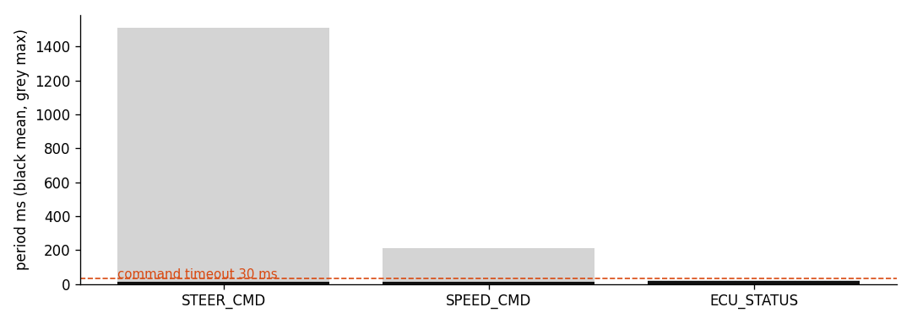
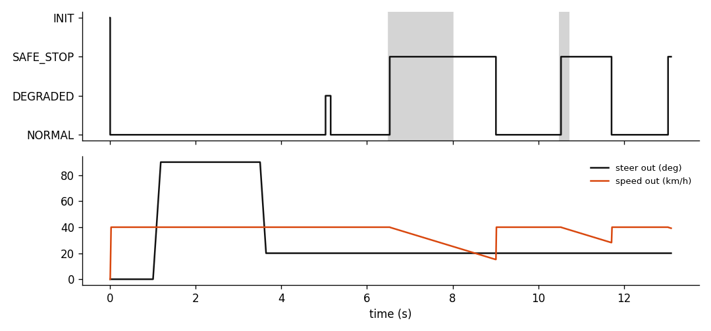

# CAN log analysis: demo.log

3077 frames over 13.10 s. 3 gaps, 100 out-of-range frames in 1 intervals, 4 E2E errors, 8 state changes.

## Message timing

| Message | ID | Count | Cycle ms | Mean | Min | Max | p99 | Stdev |
|---|---|---:|---:|---:|---:|---:|---:|---:|
| STEER_CMD | 0x100 | 1131 | 10 | 11.505 | 9.75 | 1510.055 | 10.198 | 44.994 |
| SPEED_CMD | 0x101 | 1281 | 10 | 10.157 | 2.66 | 210.046 | 10.25 | 5.597 |
| ECU_STATUS | 0x200 | 665 | 20 | 19.734 | 1.001 | 20.431 | 20.312 | 1.762 |

## Gaps (timeouts)

| message | start_s | gap_ms |
|---|---|---|
| STEER_CMD | 6.5021 | 1510.05 |
| STEER_CMD | 10.5021 | 210.05 |
| SPEED_CMD | 10.5022 | 210.05 |

## Range violations

| message | signal | start_s | end_s | frames | min | max |
|---|---|---|---|---|---|---|
| STEER_CMD | SteerAngleCmd | 2.5121 | 3.5019 | 100 | 600.0 | 600.0 |

## E2E errors

| message | kind | t_s |
|---|---|---|
| STEER_CMD | crc | 5.012 |
| STEER_CMD | crc | 5.0219 |
| STEER_CMD | crc | 5.032 |
| STEER_CMD | jump 4 | 5.0419 |

## State changes

| t_s | from | to |
|---|---|---|
| 0.0021 | INIT | NORMAL |
| 5.0324 | NORMAL | DEGRADED |
| 5.1521 | DEGRADED | NORMAL |
| 6.5321 | NORMAL | SAFE_STOP |
| 9.0121 | SAFE_STOP | NORMAL |
| 10.532 | NORMAL | SAFE_STOP |
| 11.7123 | SAFE_STOP | NORMAL |
| 13.0323 | NORMAL | SAFE_STOP |

## Figures

